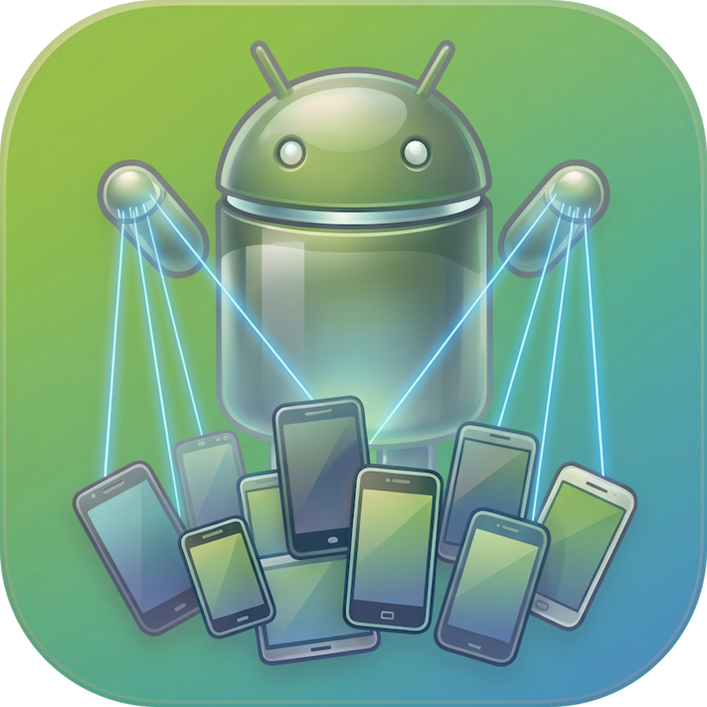
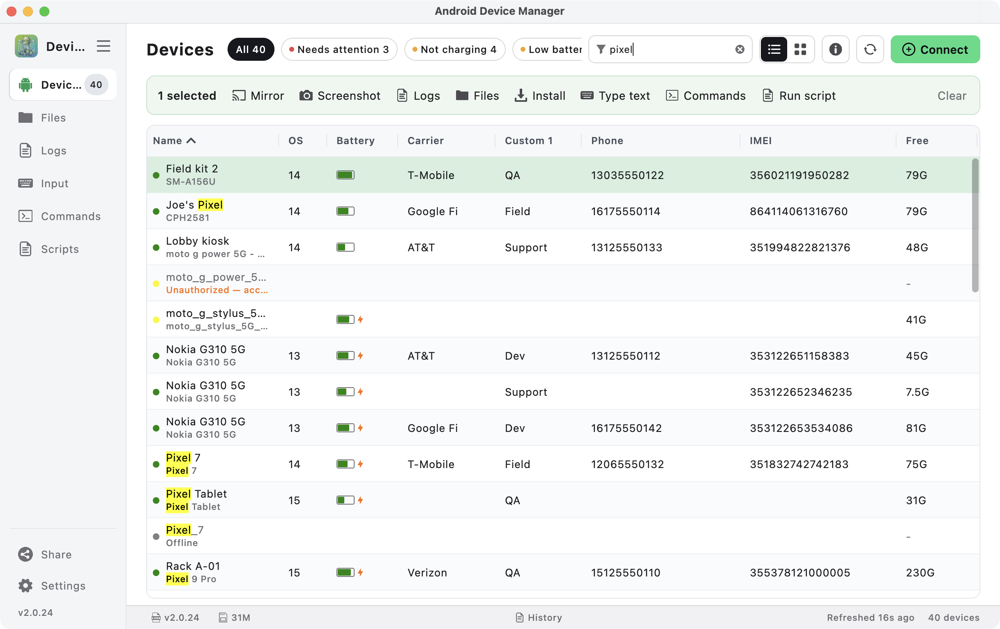
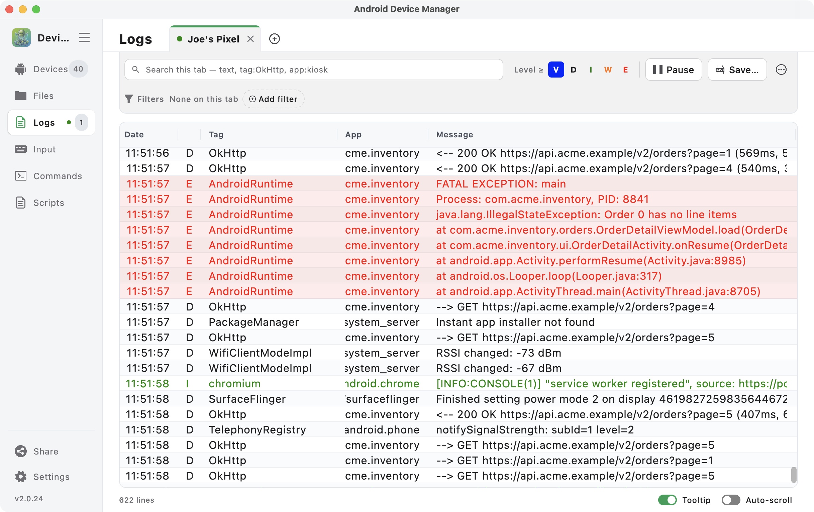
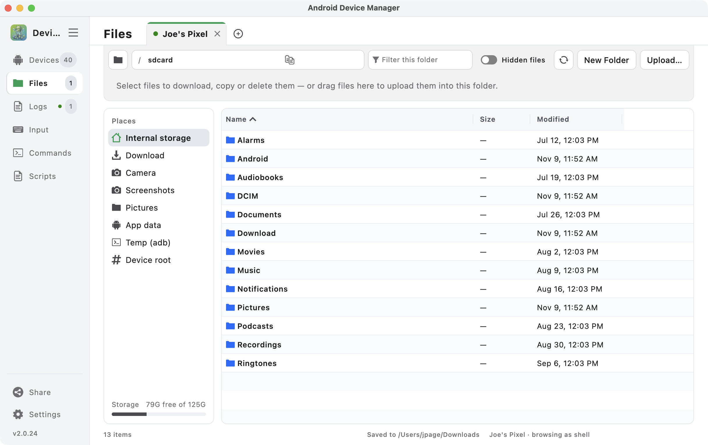
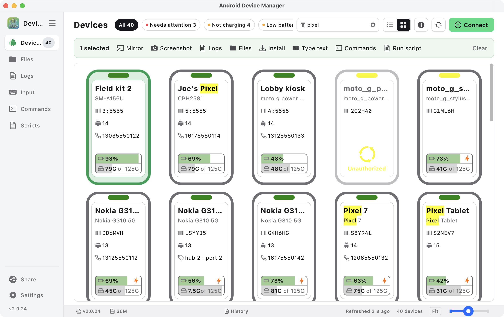
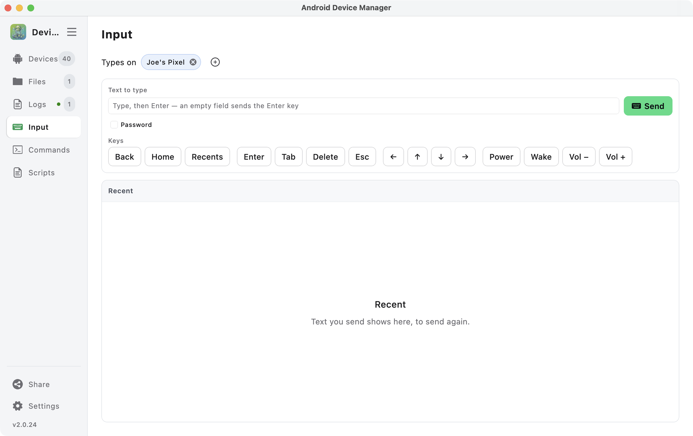
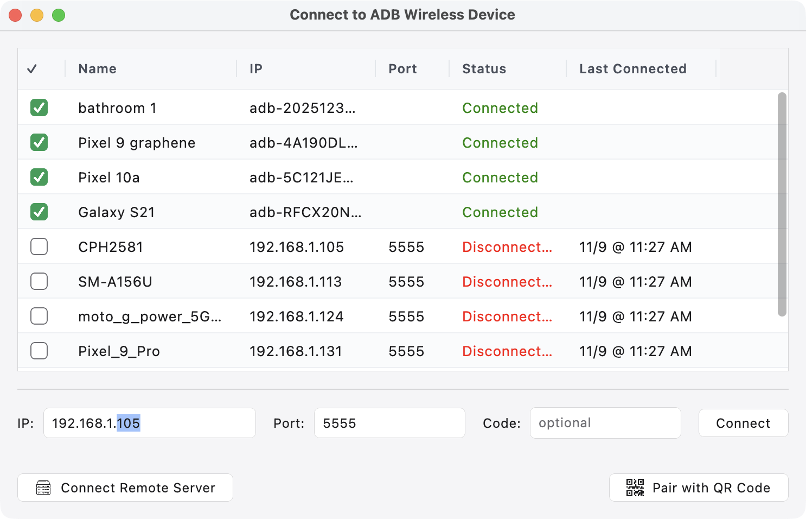
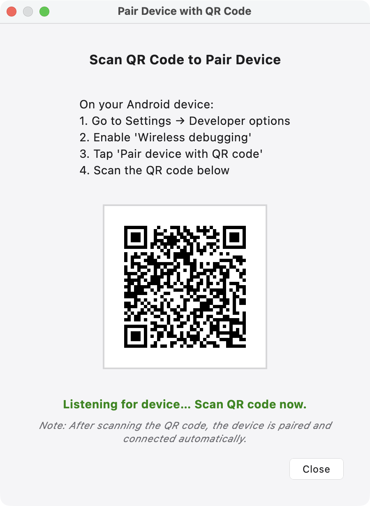

# Android Device Manager



A desktop app (macOS, Windows, Linux) for managing **one or many Android devices at once** over adb —
mirror them, read their logs, browse their files, install apps and run commands across a whole rack
of phones from one window.

This is version 2: a ground-up rewrite of the original
[Android Device Manager](https://github.com/jpage4500/AndroidDeviceManager) in Kotlin Multiplatform
and Compose. It does what the original does, in one window instead of many, and it's the base for a
phone app that's on the way.



---

## Features

**Devices**
- Every connected device, **USB and wireless**, in one table — or as icons
- Model, OS, carrier, **phone number, IMEI, battery, free space** and uptime for each
- Your own **custom properties** per device
- A details panel with a **live preview of the device's screen**
- Quick filters for devices that are **not charging, low on storage or not responding**
- Select several devices and act on all of them at once

**Do things to devices**
- **Mirror** a device and control it with the mouse and keyboard — built in, or through
  [scrcpy](https://github.com/Genymobile/scrcpy) if you have it
- Take **screenshots** of every selected device
- **Drag and drop an APK** to install it, or **any file** to copy it, onto the selected devices
- **Restart**, rename or disconnect devices
- **Type text or press keys** on many devices at once
- Run an **adb shell command** on each device and see each one's result — with saved and recent
  commands
- Run a **script** once on each device

**Logs**
- A tab per device, capturing in the background while you look at another
- Filter by level, app, tag or message, and **save filters** to combine later
- Search with highlighting, pause and resume, and **save logs to a file**

**Files**
- Browse a device's file system, with a path bar and shortcuts to common folders
- Download, upload (or drag in), rename, delete, and install an APK straight from the device

**Connect**
- Pair a device for wireless debugging by **QR code** or pairing code
- **Share Devices** — let another computer, or the phone app, use the devices plugged into this one
- See devices attached to **other computers** running Device Manager in the same list

**And**
- A **menu-bar icon** listing every device, with Mirror, Browse, Logs and Screenshot for each
- Light and dark themes, and keyboard shortcuts for everything you do often
- **Updates itself** — a new version installs the next time you open the app

---

## Screenshots

### Logs


### Files


<details>
  <summary>More screenshots</summary>

<b>Devices as icons</b><br>

<br>
<b>Type text or press keys on many devices at once</b><br>

<br>
<b>Connect wireless devices</b><br>

<br>
<b>Pair by QR code</b><br>

<br>
</details>

---

## Install

Download the installer for your computer from **[Releases](https://github.com/jpage4500/AndroidDeviceManagerKMP/releases/latest)**.

It's packaged with [jDeploy](https://www.jdeploy.com), which installs Java for the app on its own
and keeps the app up to date: when a new version is out, it's installed the next time you open the
app.

## Before you start: adb

Device Manager talks to devices through **adb**, the Android Debug Bridge. Install it, and make sure
its server is running — Device Manager reads devices from it but **doesn't start it for you**:

```
adb start-server
```

The server keeps running until you restart your computer. Any adb command starts it, so if you
already use `adb devices`, there's nothing extra to do.

Each device needs **USB debugging** turned on (Settings › Developer options), and the first time it's
plugged in, accept the "Allow USB debugging?" prompt on its screen.

[scrcpy](https://github.com/Genymobile/scrcpy) is optional — the built-in mirror works without it.

<details>
  <summary>macOS</summary>

With [Homebrew](https://brew.sh):

```
brew install --cask android-platform-tools
adb start-server
```

Optional: `brew install scrcpy`
</details>

<details>
  <summary>Windows</summary>

1. Download [SDK Platform-Tools](https://developer.android.com/tools/releases/platform-tools) and
   extract it, for example to `C:\Program Files\Android\platform-tools`
2. Add that folder to your `PATH`
3. Open a command window and run `adb start-server`

Optional: [scrcpy for Windows](https://github.com/Genymobile/scrcpy/blob/master/doc/windows.md)
</details>

<details>
  <summary>Linux</summary>

```
sudo apt-get install adb
adb start-server
```

Optional: `sudo apt-get install scrcpy`, or see [scrcpy's Linux guide](https://github.com/Genymobile/scrcpy/blob/master/doc/linux.md)
</details>

---

## Why this exists

We manage a lot of Android devices, and had used MDM software such as AirDroid and ScaleFusion to do
it. Those cost money, and remote controlling a device through them was slow and choppy.

So we took a different approach: instead of running software on every phone, we plugged them all
into one MacBook through 16-port USB hubs, and remote into that MacBook. Device Manager runs there and
controls every device with little to no lag.

Tested with **45 Android devices** on one MacBook.

---

## Bugs and ideas

Open an [issue](https://github.com/jpage4500/AndroidDeviceManagerKMP/issues). Settings › About ›
**Support / Feedback** sends the app's log along with your note on what went wrong.
